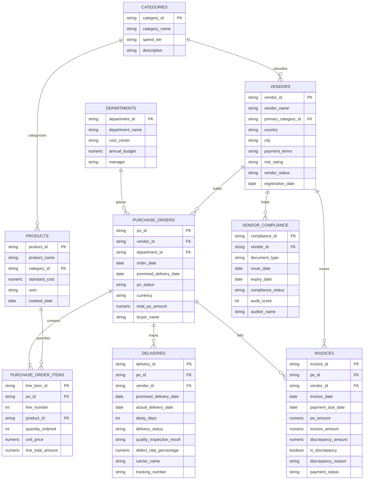

# ProcureIQ: Entity-Relationship (ER) Diagram

The following Mermaid ER Diagram models the transactional operational entities of the ProcureIQ platform, illustrating primary keys (`PK`), foreign keys (`FK`), and relational cardinality.

