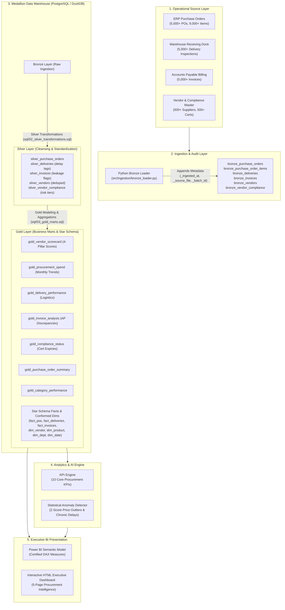

# ProcureIQ: End-to-End System Architecture

---

### Component Breakdown
1. **Operational Source Layer**: Simulates multi-system enterprise environments where POs originate in SAP/Oracle ERP, logistics events originate in warehouse management systems (WMS), and billing originates in accounts payable workflows.
2. **Ingestion & Audit Layer**: Python-powered batch loader that captures raw payloads, adds non-destructive audit stamps (`_ingested_at`, `_source_file`, `_batch_id`), and guarantees idempotent pipeline runs.
3. **Data Warehouse (Medallion Architecture)**:
   - **Bronze**: Exact replica of source CSV records.
   - **Silver**: Cleansed, deduplicated, type-cast tables with standardized date keys and referential integrity validations.
   - **Gold**: High-performance Star Schema dimensional models and aggregated domain marts.
4. **Analytics & AI Engine**: Automated engine that calculates transparent 4-pillar vendor performance ratings and statistical outlier detection.
5. **Presentation Layer**: Enterprise Power BI integration with certified DAX measures and browser-ready interactive dashboards.
